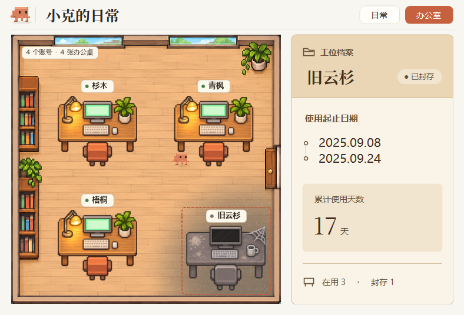

# claude-switch

给每个 Claude 账号留一张办公桌。在 Windows 上切换 Claude 桌面账号时，小克会搬到对应的工位。你可以在工作台查看本机 Claude Code 的 Token 用量，也可以把项目的本地记忆和 Skills 带到下一个账号。

An independent Windows workbench for switching Claude Desktop accounts. Each account gets a pixel-art desk. Track local Claude Code token usage and carry project memories and skills between profiles.

[下载 Windows x64 版 / Download](https://github.com/long18922272848-afk/claude-switch/releases/latest) · [从源码构建](#从源码构建) · [数据与隐私](PRIVACY.md)



*图中的昵称和日期均为虚构示例。 All nicknames and dates in this preview are fictional.*

## v1.1.0 · 小克的办公室 / Desk history

作者的 Claude 账号被封禁了，于是给小克加了一间能留下旧工位的办公室。打开「小克的日常 → 办公室」，每添加一个账号就会多一张亮着灯的桌子。从工作台移除账号后，桌子会搬到角落，变灰、积尘。点桌子可查看昵称、起止日期和累计天数。

After the author's Claude account was banned, we added a place to remember old desks. Open **小克的日常 → 办公室** (Little Ke’s Daily Life → Office). Each new account gets a lit desk. When you remove the account from the workbench, its desk moves to a dusty corner. Select a desk to see its nickname, date range and total days.

天数按本机日历计算，添加和移除当天都计入。在用工位算到今天，缺少起始记录时显示「未记录」。封存由手动移除账号触发。

Days run from the date added through today or the removal date, inclusive. An unknown start date is shown as unrecorded. Removing an account from the workbench archives its desk.

## 下载与运行

目标环境为 **Windows 10 / 11 x64、.NET Framework 4.8**，并需要已安装、可正常登录的官方 Claude 桌面端。Code 会话相关功能还需要本机存在 Claude Code 会话记录。

1. 从[最新版本页面](https://github.com/long18922272848-afk/claude-switch/releases/latest)下载 Windows x64 ZIP。
2. 将 ZIP 解压到自己选择的固定目录，运行 `claude-switch.exe`。无需安装器。
3. 保留当前 Claude 账号登录，在工作台中添加其他账号，分别完成登录。

程序未进行代码签名，Windows 可能显示发布者未知。可使用发布页的 `SHA256SUMS.txt` 核对下载文件：

```powershell
Get-FileHash .\claude-switch-v1.1.0-windows-x64.zip -Algorithm SHA256
```

目前的验证覆盖构建环境中的 Windows、自动回归和隔离界面检查，并不代表已在每一种 Windows 版本或 Claude 桌面版本上完成实测。Claude 的界面或本地文件格式变化可能影响兼容性。

## 功能

| 功能 | 行为与范围 |
| --- | --- |
| 多账号工作台 | 在官方 Claude 窗口分别登录，按独立目录识别和切换；同一账号重复登录会提示。 |
| 本地会话同步 | 将已有 Code 会话的本地索引同步到目标账号；不迁移正在运行的进程。 |
| 额度卡片 | 读取已核验的 Claude 用量控件，显示五小时／每周额度和采样时间；历史记录有独立标识。 |
| Token 统计 | 合并本机各账号可见的 Code 记录，按响应去重，分别统计输入、输出、缓存读取和缓存写入。 |
| 热图交互 | 支持近 30 天、近 6 个月和全部时间；悬停或键盘导航显示每天的日期与 Token 数。 |
| 作品对照 | 将所选范围的输入与输出换算为《小王子》的约略倍数，不包含缓存。 |
| 记忆与 Skills | 收集本地资料并保留项目作用域；可单独启用 Code hooks，在会话开始或新消息时读取最新入口。 |
| 可选任务接力 | 切换账号时核验并暂停选定 Code 任务，保存快照，再在目标账号创建续接会话。 |
| 小克与主题 | 像素角色、工位与休息间互动，支持浅色／深色主题、托盘和开机自启设置。 |

### 添加账号与授权回调

点击「添加账号」，在新开的独立 Claude 窗口中登录。若浏览器自动选中了原账号，使用浏览器的其他账号登录入口。

需要设置授权回调时，在账号「···」菜单中选择 Windows 授权回调设置，按系统提示将 `CLAUDE` 链接交给本程序的授权助手。登录期间保持面板运行，最小化到托盘也可以。授权回调只在本机转交给目标 Claude 窗口，不需要把链接发送给任何人。

首次运行默认隐藏邮箱，右上角的邮箱开关可调整面板内显示。它不会删除账号信息或改变官方 Claude 的登录身份。

### 同步与任务接力

**自动接力默认开启**，只在通过工作台切换账号时按条件触发。存在多个任务时需要选择目标任务；程序会检查账号、进程和会话状态，不能确认安全暂停或续接时会停下并说明原因。

希望只切换账号、让原任务继续运行时，关闭底部「自动接力」，或选择账号菜单中的「只切换」。单纯打开统计页或与小克互动不会开始接力。

接力是“保存上下文后在新会话继续”，不是移动内存中的任务，也不保证第三方操作严格只执行一次。普通网页聊天、Cowork 虚拟机和任意外部后台任务不属于可迁移范围。目标账号仍使用自己的模型权限和工具授权。

「立即同步」会同步本地会话索引并保存本地资料。面板运行时也会在检测到账号变化或相关窗口关闭时核对同步。已运行的 Claude 窗口可能缓存会话列表，需要重新打开 Code 页面或在任务结束后重启窗口才能看到新记录。

### 用量统计口径

Token 热图来自本机可读取的 Claude Code 日志及已经保存的用量账本。首次读取会回补可用历史，面板运行时每 30 秒更新；相同响应、同步副本和流式累计字段不会重复累加。子任务记录纳入统计，会话数只计包含有效用量的会话。

总 Token = 输入 + 输出 + 缓存读取 + 缓存写入。每日按本机时区划分。它不等同于订阅额度百分比或费用，也不能补齐其他设备、普通网页聊天或已经删除且从未读取的记录。灰色格子表示没有已记录用量。

《小王子》对照使用固定展示标尺：`（输入 + 输出）÷ 22,000`。每本约 22,000 Token 是直观估算，不是官方精确换算；译本、语言和分词方式都会影响结果。悬停对照文字可查看说明。

额度卡片与 Token 热图使用不同来源。打开对应账号的 Claude 设置用量页，或展开 Code 用量详情，可让只读页面采样获得更多信息。无法读取或过期的数据会显示状态，不把历史额度当作当前剩余额度。

### 本地记忆与 Skills

面板运行时定期核对本地资料，更新统一入口。若要让 Code 在会话开始／下一次发送消息时读取入口，可在程序所在目录运行：

```powershell
.\claude-switch.exe --enable-live-knowledge
```

这会在 Claude Code 配置中添加本程序的 `SessionStart` 和 `UserPromptSubmit` hooks，并保留原有配置备份。它不代发消息、不自动执行 Skills，也不会抹去已经加载到旧上下文中的内容。

本地资料同步不等于云端账号复制。Claude 云端记忆、云端 Skills、连接器授权、团队权限和云端聊天历史需要按官方提供的方式分别管理。

## 数据与隐私

发布包不包含开发者的账号配置、聊天记录、登录凭据、个人用量账本或本机路径。程序在**使用者自己的电脑上运行后**，会读取和生成与其账号有关的数据；它不是匿名工具，也不负责消除 Claude、Windows 或 GitHub 自身的身份记录。

为保持数据目录兼容，运行时状态默认保存在：

```text
%LOCALAPPDATA%\ClaudeAccountSync
```

其中可能包含账号身份缓存、独立 Claude 数据目录、同步日志、接力快照和记忆资料包。请勿把整个状态目录提交到 GitHub。详细清单与清理说明见 [PRIVACY.md](PRIVACY.md)。

## 命令行

在程序目录运行：

```powershell
.\claude-switch.exe --usage
.\claude-switch.exe --token-stats
.\claude-switch.exe --sync --dry-run
```

`--usage` 查看已保存的额度信息；`--token-stats` 读取本地日志、更新本地统计账本并输出 JSON；`--sync --dry-run` 检查计划中的会话同步，不提交会话索引变更。

诊断输出可能包含本机路径或账号标识，公开分享前应检查。高级使用可通过 `--state-dir` 指定状态目录，或通过 `--claude-dir` 指定 Claude Code 配置目录。不要将这些目录指向源码仓库或准备上传的文件夹。

## 从源码构建

在 Windows PowerShell 中进入仓库根目录：

```powershell
powershell -NoProfile -ExecutionPolicy Bypass -File .\build.ps1 -Test
powershell -NoProfile -ExecutionPolicy Bypass -File .\package.ps1 -SkipBuild
```

构建使用本机 .NET Framework 编译器，不需要 Node.js。第一条命令完成构建与检查，第二条复用已构建的程序。也可直接运行不带 `-SkipBuild` 的 `package.ps1`，由脚本先构建并执行回归检查。

打包脚本按文件清单生成 `dist/` 下的 Windows ZIP 与 SHA-256 校验文件。ZIP 内包含 `claude-switch.exe`、`README.md`、`PRIVACY.md`、`LICENSE`、`START-HERE.txt` 和说明页使用的虚构账号示例图。

回归测试使用临时目录和虚构身份。`ui-previews/native-review.ps1` 用于隔离界面渲染，`ui-previews/native-popup-smoke.ps1` 用于屏幕范围之外的原生浮层检查；这些检查不等同于在所有真实 Claude 任务中执行过端到端接力。

要重现办公室示例，在 Windows 上运行 `ui-previews/office-review.ps1`。它会创建临时账号记录，检查新增和封存工位、两种主题及缩放布局，并将示例图写入 `ui-previews/`。

## 更新与移除

更新时先从托盘菜单退出工作台，再解压新版覆盖程序文件。启用过开机自启、协议回调或 Code hooks 时，尽量保留程序所在路径；移动程序后应重新设置对应入口。

移除前先关闭开机自启，将 Windows 的 `CLAUDE` 默认应用改回官方 Claude，并从 Code 的 hooks 配置中移除本程序的调用。之后退出工作台、删除程序目录。运行时数据需要单独处理，详见 [PRIVACY.md](PRIVACY.md)。

## 许可

项目源码使用 [MIT License](LICENSE)。Claude、Anthropic 及其相关服务名称属于各自权利人；本项目不由 Anthropic 提供、认可或维护。
